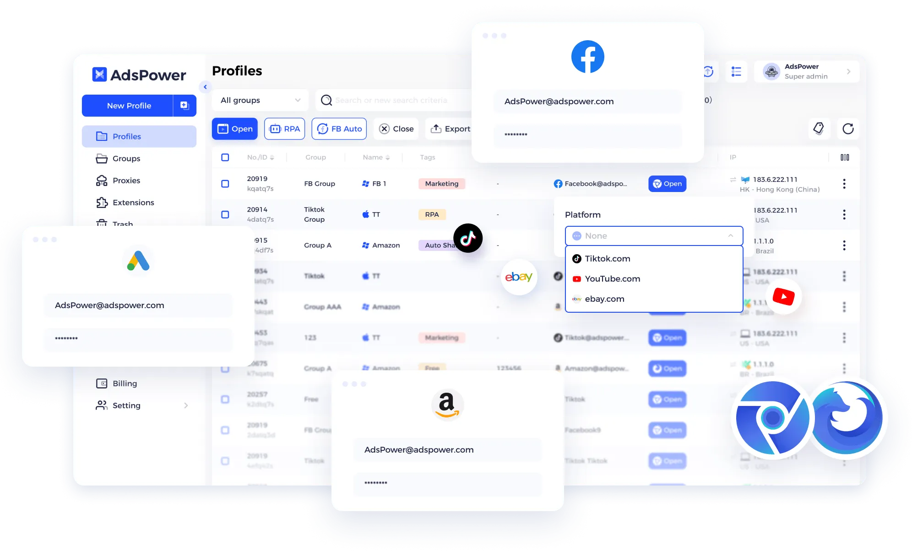

# AdsPower 免费版够用吗？环境数量、RPA 与团队费用

<!-- BEGIN GENERATED:quick:adspower -->
> **免费版**：2 个环境，1 人
>
> **付费起价**：按环境、成员和周期报价
>
> **常用功能**：可视化 RPA、流程模板与团队权限管理
<!-- END GENERATED:quick:adspower -->

AdsPower 的长期免费版适合个人管理少量固定环境，7 天完整功能试用则方便团队体验操作流程。它比较值得关注的是可视化 RPA、流程模板和成员权限，尤其适合已有固定自动化任务的团队。

*AdsPower 官方产品图：环境列表与平台配置入口。 [图片来源](https://www.adspower.com/)*

## 免费 2 个环境，7 天试用结束后怎么用？

长期免费版提供 **2 个环境，限单人使用**。如果一直只维护这两组账号，可以继续留在免费版；环境更多或需要同事分别登录协作，就需要配置付费方案。

7 天完整功能试用适合集中体验 RPA 和团队功能。试用结束后，长期免费的环境数量仍是 2 个。

## 套餐与价格

<!-- BEGIN GENERATED:plans:adspower -->
| 套餐 | 环境数量 | 人员 | 价格 |
|---|---|---|---|
| Free | 2 个环境 | 1 人 | 免费 |
| Professional | 按配置选择 | 成员按需添加 | 按环境、成员和周期报价 |
<!-- END GENERATED:plans:adspower -->

付费金额随环境数量、额外成员和付款周期变化。在[价格页](https://www.adspower.com/pricing)选好需要的窗口和成员，再比较月付与长周期付款的总费用。

## RPA 流程适合哪些任务？

AdsPower 的 [RPA](https://help.adspower.com/docs/rpa)支持页面点击、输入、滚动、条件判断和错误处理。流程可以按业务分组，也能把做好的模板分享给其他账号。

对于反复处理同一批页面的团队，流程复用可以减少重复搭建。已经积累了 AdsPower 模板时，换工具还需要考虑原流程的迁移工作。

## 多人脚本任务怎样分配权限？

[Local API](https://help.adspower.com/docs/api)提供环境创建、修改、启动和关闭等接口。管理员可以管理密钥，并向成员开放对应的调用权限，适合由不同同事维护脚本和账号。

预算中除了窗口数量，也要计入实际需要独立登录的成员数。个人希望直接免费使用同步器、RPA 和 API，则可以继续阅读[比特浏览器与 AdsPower 对比](../comparisons/bitbrowser-vs-adspower.md)。

## 先选对客户端，再安排环境分组

官方[下载页](https://www.adspower.com/download)提供 Windows、macOS 与 Ubuntu Desktop 版本。Windows 为 10 及以上，macOS 为 11 及以上，Ubuntu Desktop 为 22.04 及以上；Mac 要按 Intel 或 Apple Silicon 选择安装包。

团队可以按客户或项目整理环境分组，把浏览器配置、代理和操作流程对应起来。已经有模板的团队，交接时同时确认模板、环境和成员授权。

需要比较 RPA 与云端会话，可继续看[AdsPower vs GoLogin](../comparisons/adspower-vs-gologin.md)。代理和环境的实际检查方法见[配置指南](../guides/how-to-configure-proxy.md)。

[首页](../README.md) · [产品目录](../browsers/README.md) · [全部对比](../comparisons/README.md) · [入门与配置](../guides/README.md)
