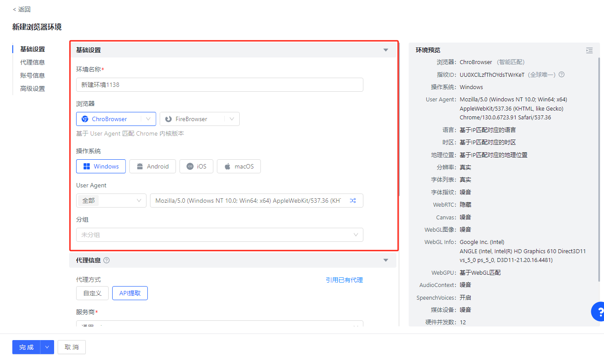

# Hubstudio 免费版怎么用？环境保存、打开次数与 VIP 功能

<!-- BEGIN GENERATED:quick:hubstudio -->
> **免费版**：保存环境不限
>
> **付费起价**：99 元/月起
>
> **常用功能**：环境保存不限，免费每天打开 20 次；VIP 增加批量操作
<!-- END GENERATED:quick:hubstudio -->

Hubstudio 的免费版不限制保存的环境总数，每天可以打开 20 次。它比较适合已有较多固定环境、每天只操作其中一部分的用法；需要批量操作和 API 时，再看 VIP 的日打开额度。

*Hubstudio 官方帮助截图：创建环境时选择内核、操作系统和 User Agent。 [图片来源](https://support-orig.hubstudio.cn/645e/2879)*

## 保存数量和打开次数分别计算

环境创建并保存后，可以继续留在列表中；日常启动窗口消耗打开次数。免费版适合低频使用，VIP 按所选档位提高到每日 500～2,000 次，环境数据同步与导入也可以结合日常分工使用。

<!-- BEGIN GENERATED:plans:hubstudio -->
| 套餐 | 环境数量 | 价格 |
|---|---|---|
| 免费版 | 保存环境不限 | 免费 |
| VIP | 保存环境不限 | 99 元/月起 |
<!-- END GENERATED:plans:hubstudio -->

价格页的 VIP 标准价为 99 元/月起，具体日打开额度与付款方案在客户端选择。成员数和云端空间属于当前限免权益，选择团队方案时可以直接在客户端确认所需资源。

## VIP 增加哪些操作？

VIP 在免费版基础上增加环境数据导出、API 自动化、窗口同步和批量操作。已经积累大量配置、需要分批启动或交给脚本处理的用户，可以围绕每日打开量安排套餐。

个人只需要 10 个以内环境，但希望免费使用同步器、RPA 和 Local API，可以同时看[比特浏览器](bitbrowser.md)。两者适合的免费使用方式不同：一个强调保存数量，一个将少量环境与自动化入口放在一起。

## Windows、Mac 和服务器怎样使用？

桌面客户端有 Windows 与 Mac 版本。Mac 提供 Intel 与 Apple Silicon 安装包；[Mac 帮助页](https://support-orig.hubstudio.cn/7794/a06d)单独列出了内核、同步器与窗口排列的功能差异，Mac 团队应先确认自己需要的工具。

服务器自动化另外有 CLI 与无头客户端的工作方式，Linux 用户可以在[开发文档](https://api-docs.hubstudio.cn/)中打开“Hubstudio CLI 命令行操作指南”。这是服务器运行入口，与桌面窗口管理分别考虑。

[Hubstudio 套餐](https://www.hubstudio.cn/pricing/index.html) · [客户端下载](https://www.hubstudio.cn/download/index.html) · [比特 vs ixBrowser：保存数量与操作次数](../comparisons/bitbrowser-vs-ixbrowser.md)

[首页](../README.md) · [产品目录](../browsers/README.md) · [全部对比](../comparisons/README.md) · [入门与配置](../guides/README.md)
