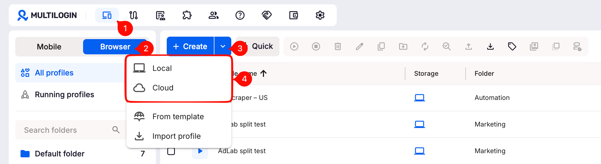

# Multilogin 免费版与 Pro 价格：浏览器、云手机和代理

<!-- BEGIN GENERATED:quick:multilogin -->
> **免费版**：5 个配置
>
> **付费起价**：11 美元/月
>
> **常用功能**：在同一平台管理浏览器、云手机与代理
<!-- END GENERATED:quick:multilogin -->

Multilogin 把浏览器环境、云手机与内置代理放在同一平台。免费版提供 **5 个配置名额**，并赠送 **200MB 代理流量**和 **1 个云手机配置的 30 分钟使用时长**，适合体验两类工作环境。

## 免费资源怎样使用？

浏览器和云手机共用这 5 个配置名额。代理流量与移动时长是一次性赠送，用完后按需要购买后续资源。

只使用浏览器时，也可以给环境绑定自己准备的代理；需要操作 App 时，再安排云手机配置和运行时长。

## Pro 按月还是按年支付？

<!-- BEGIN GENERATED:plans:multilogin -->
| 套餐 | 环境数量 | 价格 |
|---|---|---|
| Free | 5 个配置 | 免费 |
| Pro 10（月付） | 10 个配置 | 11 美元/月 |
| Pro 10（年付） | 10 个配置 | 85 美元/年 |
<!-- END GENERATED:plans:multilogin -->

Pro 10 按月为 **11 美元**，按年为 **85 美元一次付清**，折算每月约 7.08 美元。短期使用可以按月，确定长期使用后再比较年付费用。

## 支持哪些电脑系统？

客户端支持 Windows 10 及以上的 64 位系统、macOS 14 及以上，以及 Ubuntu 22 及以上。安装包与系统要求可查看[官方说明](https://multilogin.com/help/en_US/minimum-system-requirements)。

有 Ubuntu 工作机，或希望统一管理网页端与移动端任务的用户，可以结合这一点选择。

## 和常规多窗口浏览器怎么比较？

如果主要任务是在 Windows 或 Mac 上管理网页账号，比较环境数量和自动化入口即可。比特免费版提供 10 个环境、同步器、RPA 与 Local API，适合先搭建个人多窗口流程。

Multilogin 则适合同时关注浏览器、云手机和内置代理的用户。可以结合[11 款浏览器对比](../README.md)，按自己常用的设备与任务选择。

## 云同步、云手机和云端浏览器怎样区分？

*Multilogin 官方帮助截图：创建环境时选择 Local 或 Cloud 保存方式。 [图片来源](https://multilogin.com/help/en_US/cloud-and-local-storage)*

保存到云端的环境配置，用于在不同设备继续打开原资料；云手机则提供 Android 运行环境。选择前先确定任务是在网页还是 App，再分别计算浏览器配置、移动运行时间与代理流量。

已有自己的代理时，可以按环境保存并检查实际出口，方法见[代理配置指南](../guides/how-to-configure-proxy.md)。需要自己部署浏览器的开发者，也可以比较[开源浏览器](../guides/best-open-source-fingerprint-browsers.md)与 [Kameleo Docker](kameleo.md)。

[首页](../README.md) · [产品目录](../browsers/README.md) · [全部对比](../comparisons/README.md) · [入门与配置](../guides/README.md)
