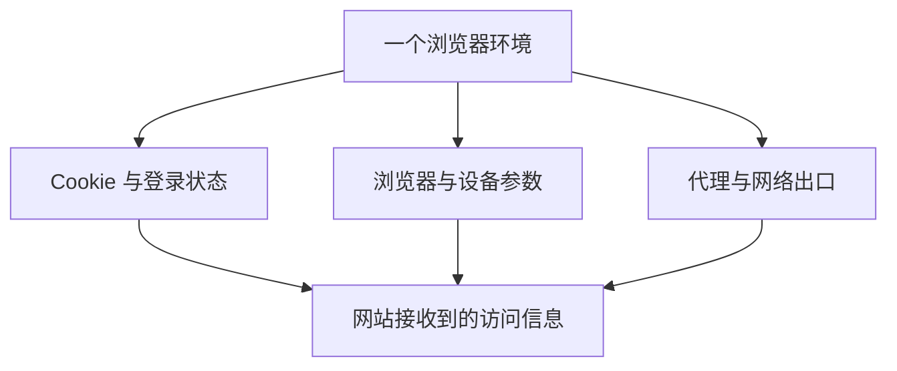

# 浏览器指纹是什么？IP、Cookie、Canvas 与独立环境说明

浏览器指纹是网站把浏览器和设备的多项特征组合起来，辅助识别访问者的一种方式。它通常涉及浏览器版本、操作系统、屏幕、字体和图形渲染结果，没有一个所有网站通用的“设备指纹编号”。网站选择的特征、组合方法和判断用途各不相同。

同一台电脑上清除 Cookie 后，部分设备特征仍然可以被读取；换了网络，字体、显卡和浏览器设置也可能继续保持原样。这是浏览器指纹与网站本地保存数据的区别。

## IP、Cookie 和浏览器指纹怎样配合？

| 信息 | 来自哪里 | 通常用来判断什么 |
|---|---|---|
| IP 地址 | 当前网络出口，包括代理或 VPN | 网络、运营商与大致地区 |
| Cookie / 本地存储 | 网站保存在当前浏览器资料中的数据 | 登录会话、偏好与访问状态 |
| 浏览器指纹 | 浏览器 API、HTTP 信息及设备特征 | 浏览器配置、设备类型及特征组合 |

例如，一个客户的工作环境可以保存它自己的登录状态、代理和浏览器设置。下次继续工作时打开同一个环境，就能沿用这些资料；把另一个客户放进其他环境，日常查找和交接也更清楚。

## 常见指纹参数分别是什么？

| 参数 | 网站能观察到的内容 | 配置时怎样理解 |
|---|---|---|
| User-Agent / Client Hints | 浏览器、系统及版本相关信息 | 所选浏览器类型与系统要相互对应 |
| Canvas | 文字或图形绘制后的像素结果 | 会受到字体、系统和图形处理方式影响 |
| WebGL | GPU 信息、图形能力与渲染结果 | 需要结合显卡和渲染环境一起看 |
| Audio | 音频处理过程产生的数值特征 | 属于多种可组合信号中的一项 |
| 字体与屏幕 | 字体列表、字形尺寸、屏幕和窗口参数 | 保留适合日常操作的一套配置 |
| 语言与时区 | 浏览器语言、时间偏移及格式 | 按真实工作需要和访问地区配置 |
| WebRTC | 实时通信能力及连接候选地址 | 使用代理时检查是否出现额外公网出口 |

指纹参数并不是改得越多越好。创建环境后，先保留客户端生成的完整配置，按需要设置代理和语言，再检查各项信息是否符合预期。已经长期使用的环境，日常应继续复用它的资料。

## 无痕模式、Chrome 多用户和指纹浏览器有什么区别？

无痕模式建立临时浏览会话，关闭全部无痕窗口后清除该会话保留的浏览数据。它仍通过当前网络访问网站，也不会因为多开一个无痕窗口就自动换一套硬件特征。

Chrome 多用户可以分别保存书签、扩展和登录资料，适合分开个人与工作用途。指纹浏览器进一步把代理、浏览器参数、环境分组和批量操作集中到环境管理界面，方便维护更多独立工作空间。

如果只是临时登录另一个账号，普通浏览器功能可能已经够用；需要长期保存多组环境、为它们分配代理或交给同事接手时，再比较[产品目录](../browsers/README.md)里的环境管理工具。

## 创建好环境后，先看哪几项？

先确认浏览器能打开网站，出口 IP 与所选代理一致，再看语言、时区与系统信息。登录完成后关闭并重新打开同一环境，检查网站会话是否按预期保留。具体操作可按[代理配置指南](how-to-configure-proxy.md)和[指纹检测指南](how-to-check-browser-fingerprints.md)进行。

比特浏览器的 10 个免费环境可以分别保存这类工作配置，免费版包含同步器、RPA 和 Local API。准备从手动操作转向批量管理时，可继续阅读[功能说明](../browsers/bitbrowser.md)。

资料：[MDN 指纹识别](https://developer.mozilla.org/zh-CN/docs/Glossary/Fingerprinting) · [Chrome 无痕模式说明](https://support.google.com/chrome/answer/95464?hl=zh-Hans)

[首页](../README.md) · [产品目录](../browsers/README.md) · [全部对比](../comparisons/README.md) · [入门与配置](../guides/README.md)
